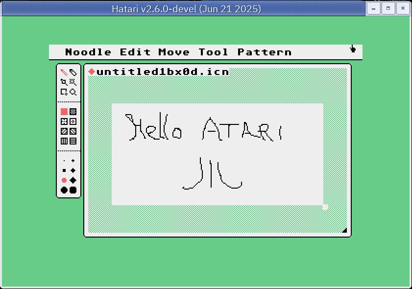

# uxntari

A uxn/varvara virtual machine for the Atari ST, written in C and cross-compiled with `m68k-atari-mint-gcc`. It follows the current uxn/varvara specification (same behaviour as the uxn11 reference emulator).

`UXN.PRG` is included, ready to copy to a floppy image or a hard disk.

## Build

    make               # builds UXN.PRG
    make host-test     # core, devices and video against uxn11, on the host
    make audio-test    # audio against the old uxn reference code

`host-test` needs `gcc`, `python3`, `git` and `uxnasm`, and clones uxn11 for the official test roms and as reference. `audio-test` clones the old uxn repository.

## Usage

Copy `UXN.PRG` and some `.rom` files to the same directory (or floppy). Without argument, `UXN` lists the `*.rom` files of the current directory. Pick one with Up/Down and Return, or click it.

- `[ Basse ]` / `[ Moyenne ]` buttons, or F3 / F4: low resolution (320x200, the default) or medium resolution (640x200). F1 and F2 are left to the ROMs.
- When the ROM ends or Undo is pressed you are back in the list. Undo or `[ Quitter ]` returns to the desktop and restores the original resolution and palette.
- `UXN rom [args]` runs one ROM directly. Arguments are sent to the console device.
- High resolution (640x400 mono) is supported.

## Supported

| Device     | State |
|------------|-------|
| core       | complete, passes the official opctest |
| system     | colors, halt, debug, expansion (fill/copy, 16 banks of 64K allocated on demand, loaded from the end of the ROM) |
| console    | output, error, debug, arguments |
| screen     | pixel, fill, 1bpp and 2bpp sprites, layers, auto, resize (up to the hardware size) |
| controller | arrows, Home and Control/Alt/Shift (A, B, Select), typed keys |
| mouse      | fed by the IKBD |
| file       | complete except removal of directories |
| datetime   | complete |
| audio      | four voices on the YM2149 (see below) |

## Gamepad emulation

The ST has no gamepad and a joystick has one button, so the Varvara controller is emulated by the keyboard. The mapping lives in the controller device, so it applies to every ROM, whatever it is: any ROM that reads `Controller/button` gets it, with nothing to configure per ROM. (The joystick ports are not read.)

| Varvara button | ST key |
|---|---|
| Up, Down, Left, Right | arrow keys |
| A | Control |
| B | Alt |
| Select | Shift (left or right) |
| Start | Home |

Other keys are sent as typed characters (`Controller/key`). Control, Alt and Shift are polled every frame, so chords such as A + arrow work. TOS reports Control + left / right as their own scan codes (0x73 / 0x74), and Shift + arrow with an ASCII digit; both are mapped back to the plain arrows. The ST keyboard does not report key releases for the arrows: see Limits.

## Limits

- The ST keyboard does not report key releases: an arrow is considered released a few frames after its last repeat.
- Expansion banks use ST memory (64K each, only when used). The console cannot start child processes.
- The ST has no sample playback. A note (sample of 256 bytes or less) is played as a square wave on the YM2149 at the right pitch, a longer sample (drums, voice) as a burst of noise with the right volume envelope. Voice 4 only sounds when voice 3 is idle. The timbre is an approximation.
- The key click and bell are turned off while UXN runs and restored on exit.
- Checked only in Hatari with an old EmuTOS (floppy image): palette, sprites, selector, mouse, sound. Not checked: real hardware, STE/TT/Falcon, speed.

## Files

- `st.c`: the ST frontend (video mode, palette, keyboard, IKBD mouse, YM2149, ROM selector, frame loop).
- `uxn.c`: the core. `dev.c`: system, console, controller, mouse, datetime. `vid.c`: screen device and rendering into ST bitplanes. `file.c`: file device. `audio.c`: audio model.
- `tests/`: host test suite.

## License

BSD 2-Clause, see `LICENSE`. The parts derived from uxn/uxn11 stay under their MIT license, see `NOTICE`.

## Credits

- Based on the idea of **STuxn** by bartitsu59 (https://framagit.org/Bartitsu59/stuxn): a uxn implementation for the Atari ST that writes sprites straight into the bitplanes. This C code is a new implementation of that design, not a copy of its Pascal code.
- uxn and varvara are by Devine Lu Linvega and Hundred Rabbits. `uxn.c` follows the style of uxn11 and `audio.c` the audio code of the old uxn repository (MIT license, see `NOTICE`). The tests use uxn11 as reference.
