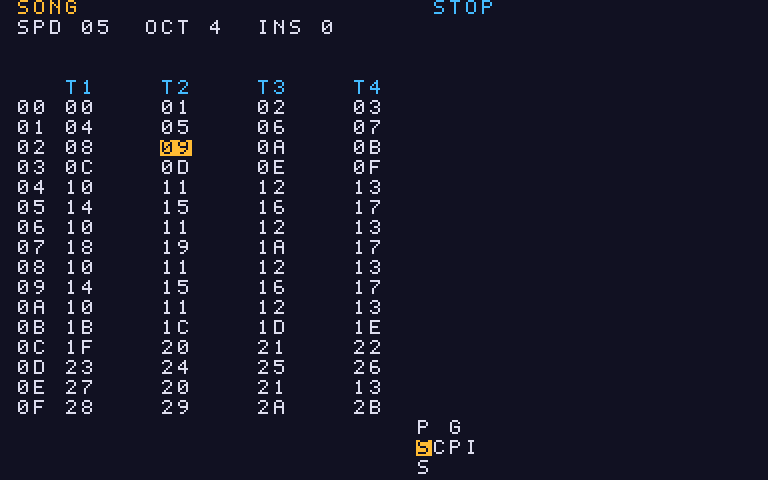
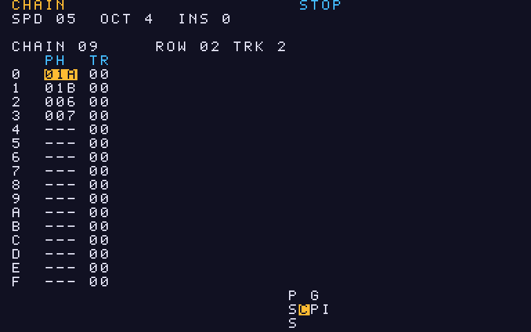
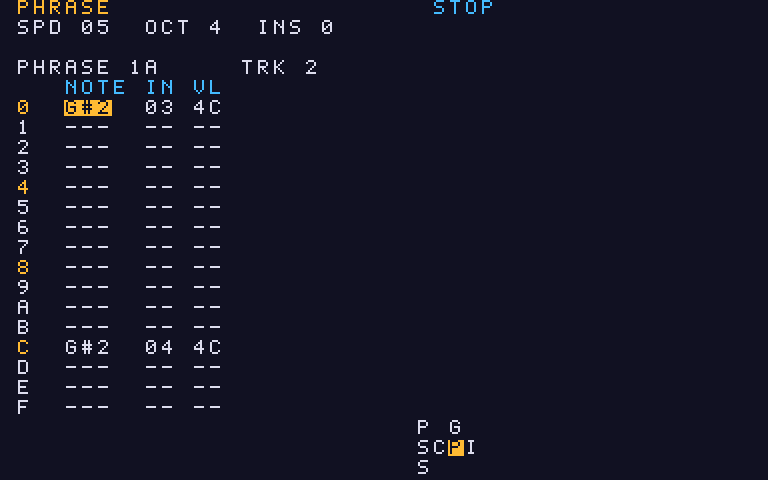
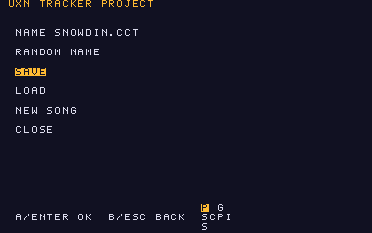
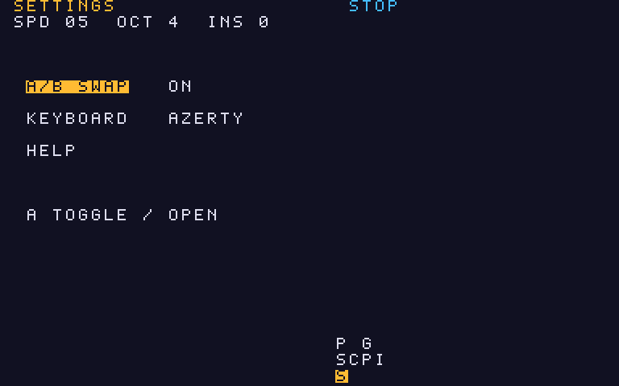
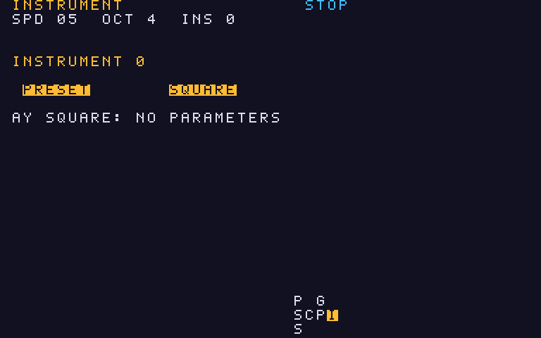

# uxntracker

**English** | [Français](README-fr.md)

A small 4-voice tracker for [Varvara/Uxn](https://wiki.xxiivv.com/site/uxntal.html), written in Uxntal.
Four channels, 8 instruments (one AY-style square and 7 SID-style instruments), and a `.cct` file in the same
text format as [ChooChooTracker](https://github.com/luginf/Choochootracker): what is saved here reopens in CCT
(4 tracks, AY1 and SID instruments), and a `.cct` written by CCT loads here.

```
make            # assemble tracker.rom
make run        # run with uxn2 at x2 zoom (song.cct is read/written in the current folder)
make run11      # run with uxn11 (X11, no audio: use uxn2 for sound)
make test       # save / reload round trip under uxncli, no screen
make cct-check  # have the real CCT loader read the test file (see below)
make ds         # Nintendo DS variant: tracker-ds.rom, 256x192 screen (make run-ds to try it at x3)
make data       # regenerate font, period table and .cct texts (tools/gen_data.py)
```

The screen is 384x240. The ROM is 24 KB. The DS variant (`tools/make_ds.py`) is 256x192: 8 px lines, everything else
is identical (every screen fits in 32 columns). It starts without the A/B swap. It has only been seen under uxn2,
not on a real DS.

## Usage

The song follows the CCT model: a **song** of 64 rows over 4 tracks, which cites **chains** (128 at most, 16 rows of
phrase + transposition), which cite **phrases** (128 at most, 16 rows of note + instrument + volume).
Tracks are independent and follow CCT playback: each one follows its own chain and its own song row. A chain ends
at its first empty row, then the track moves to the next song row; if that cell is empty (or after row 64), the
track goes back to the start of the block of non-empty cells it has just finished. A track whose start cell is empty stays silent.
The tempo is a number of 50 Hz ticks per row (like CCT, 06 by default), set in the Groove screen.

### Screens

As in CCT, you move between screens with **Select + direction**; the `SCPI` map at the bottom right
shows the current screen. There is no Table screen yet.

```
 PROJECT              GROOVE
    |                 |
  SONG --- CHAIN --- PHRASE --- INSTRUMENT
    |
 SETTINGS
    |  (HELP line)
  HELP
```

Song has Project above and Settings below; Chain is to the right of Song, Phrase to the right of Chain,
Instrument to the right of Phrase; Groove is above Phrase. Help opens from the HELP line of Settings
(Select + up goes back). Tab goes to the next screen of the row (Song, Chain, Phrase, Instrument).

| Screen | Content | Cursor |
|---|---|---|
| SONG | 16 rows per page, 4 columns (T1 to T4) of chain numbers | d-pad; B + up / down jumps 16 rows |
| CHAIN | the chain under the song cursor: 16 rows (phrase, transposition) | d-pad; B + d-pad moves the song cell |
| PHRASE | the phrase of the chain row: 16 rows (note, instrument, volume `VL` 00 to 7F; row numbers 0, 4, 8 and C have another color) | d-pad; B + up / down changes chain row, B + left / right changes track |
| INSTRUMENT | the current instrument (see below) | up / down picks the field |
| PROJECT | file name, SAVE, LOAD, NEW SONG, CLOSE | up / down |
| SETTINGS | A/B SWAP, KEYBOARD (AZERTY / QWERTY), HELP | up / down, A changes or opens |
| GROOVE | tempo | A + left / right |
| HELP | command reminder on 3 pages (pad, screens, keyboard) | left / right (or Select + left / right) changes page, B goes back to Settings |

The screenshots below show `snowdin.cct` ("Snowdin Town", by Jimmy-DS, after Toby Fox) loaded;
`python3 tools/screenshots.py snowdin.cct` regenerates them, with no window (see Verification).

**SONG**: one line per song row, one column per track; the cursor is on chain 09 (row 02, track T2).



**CHAIN**: the chain under the song cursor, 16 rows of phrase (`PH`) and transposition (`TR`).



**PHRASE**: 16 rows of note, instrument (`IN`) and volume (`VL`); rows 0, 4, 8 and C have another color.



Opening a screen creates nothing: a chain or a phrase is allocated (the first free number) when you write to it,
with A or with a piano key. If none is left, the `NO FREE SLOT` message appears.

### Pad and keyboard

The pad commands follow those of [ChooChooTracker](https://github.com/luginf/Choochootracker/blob/main/docs/USER_MANUAL.md)
(A = EDIT, B = OPT, Start = PLAY, Select = SELECT). On the keyboard: Alt = A, Ctrl = B, Shift = Select, Home = Start
(uxn does not see the X and Z keys that CCT uses by default).

**A and B swapped**: emulators send Ctrl for A and Alt for B, but A is on the right in CCT and on a
gamepad. The tracker therefore swaps the two buttons (`tracker.rom` starts that way; the `\` key or the **A/B SWAP** line
of the Settings screen toggles it). The swap applies to everything coming in, including a real gamepad:
the DS variant starts without the swap.

| Pad | Action | CCT equivalent |
|---|---|---|
| d-pad | move the cursor | same |
| A (short press) | empty cell: places the last value (chain, phrase, note, instrument); note: replays it | tap EDIT |
| A + left / right | value -1 / +1 | EDIT + left / right |
| A + up / down | value +1 / -1 octave (notes), +16 / -16 (chains, phrases) | EDIT + up / down |
| A + B | empty cell: OFF note; otherwise clears the cell | EDIT + OPT |
| B + d-pad | depends on the screen (see the screen table) | OPT + direction |
| B + left / right (Instrument) | previous / next instrument (0 to 7) | OPT + left / right |
| Select + d-pad | neighbouring screen | SELECT + direction |
| Start | play / stop (from the song row under the cursor) | PLAY |
| A + Start (Instrument) | audition the instrument | EDIT + PLAY |
| Start (Phrase screen) | plays only the phrase under the cursor, looped, on the cursor's track; Start stops it | PLAY |
| Select + Start (Phrase screen) | plays all chains from the song row under the cursor, like Start elsewhere | SEL + PLAY |
| B + Start | panic: playback stopped, the 4 voices reset and cut (NEW SONG and LOAD do it too) | OPT + PLAY |
| A twice quickly (Song, Chain) | on a chain or phrase already placed, moves to the next free number | double EDIT |

In the Instrument screen: up / down picks the field, A + left / right changes the value by a fine step,
A + up / down by a big step (like EDIT on a value in CCT); the arrows alone change nothing.
In PROJECT: up / down, A confirms, B closes (or answers no), Select + down closes too.

Differences from CCT: no Table screen and no multi-step groove (a single tempo); no selection or
copy-paste from the pad; an instrument is entered with A on the `IN` column of the phrase;
jazz mode has no Insert, no Ctrl+S, and no row deletion with shift (Backspace and Delete only clear the cell).

| Keyboard | Action |
|---|---|
| Esc | jazz mode on / off (`JAZZ` indicator): only this mode enables the piano keys on PHRASE |
| piano key row (jazz) | place a note (and play it), then move down one row |
| `[` `]` or `-` `=` | octave -1 / +1 (0 to 7), used by jazz mode |
| `'` | OFF note, then move down one row |
| Backspace / Delete | clear the cell |
| Space or Home | play / stop |
| `\` | swap A and B (see above) |
| `;` | AZERTY / QWERTY keyboard layout |
| Tab | next screen (Song, Chain, Phrase, Instrument) |
| Enter | PROJECT screen |

The note placed by A and jazz mode use the selected instrument (`INS`). In the Instrument screen,
the piano keys audition the sound without writing, even outside jazz. Naming the file needs a keyboard;
without a keyboard, `song.cct` is the default name.

During playback the display follows the song; you can edit while playing.

The piano keys, on two rows (the row shown at the right is that of the active layout):

```
QWERTY  low  : z s x d c v g b h n j m    high : q 2 w 3 e r 5 t 6 y 7 u
AZERTY  low  : w s x d c v g b h n j ,    high : a . z . e r . t . y . u
```

Each row is a chromatic octave from C to B; the top row is the octave above.
In AZERTY the sharps of the top row are not ASCII keys without Shift, so they are missing.

## On Atari ST (uxntari)

Use `tracker-ds.rom`: the screen of the normal version (384x240) is larger than the ST low resolution
(320x200), while the DS variant's (256x192) fits. `uxntari` does not read the joystick (an Atari joystick has
only one fire button): the gamepad is emulated by the ST keyboard.

| Gamepad button | Key on the ST |
|---|---|
| d-pad | arrows |
| A | Control (Alt once the buttons are swapped with `\`) |
| B | Alt (Control once swapped) |
| Select | Shift (left or right) |
| Start | Home |

Modifiers are read continuously, so combinations (A + arrow, B + arrow, Select + arrow) can be held normally.
The ST keyboard does not report arrow key releases: an arrow is considered released a few frames after the
last repeat, which is enough for short presses.
The jazz-mode piano keys (Esc) and the file name are typed on the ST keyboard like anywhere else.

## PROJECT screen

Enter (or Select + up from SONG) opens the screen: **NAME**, **RANDOM NAME**, **SAVE**, **LOAD**, **NEW SONG**,
**CLOSE**. Up / down to choose, A (or Enter) to confirm, B (or Esc) to close, Select + down closes too.
A `*` next to the title shows unsaved changes; LOAD and NEW then ask for confirmation (Y / N,
or A / B), and SAVE asks for confirmation if the file already exists.

- **NAME**: A starts editing the name (without the extension, `.cct` is added automatically, 11 characters at most).
  Up / down changes the letter under the cursor (a-z, 0-9, `-`, `_`), left / right moves the cursor, the free cell
  on the right adds a letter, B deletes the last letter, A confirms. On a keyboard you can also type the name.
- **RANDOM NAME**: an 8-letter name (consonant, vowel, ...), to save without a keyboard.
- **LOAD**: lists the `.cct` files of the current folder (16 at most, names of 11 characters at most, from a single 1 KB read of the folder); up / down
  chooses, A loads, B goes back. If the folder cannot be read or holds no `.cct`, the current name is loaded.

The map at the bottom right shows the current screen: `SCPI` in the middle, `P` (Project) above `S`, `G` (Groove)
above `P`, `S` (Settings) below.



## SETTINGS screen

Select + down from SONG. Three lines, up / down to choose: **A/B SWAP** (A changes the value), **KEYBOARD**
(AZERTY / QWERTY, A changes) and **HELP** (A opens the help, on 3 pages; B leaves it).



## Instruments

Each phrase row carries a note and an instrument number (the one selected when it was entered,
shown as `INS` at the top; B + left / right in the Instrument screen changes it). Instrument 0 is the AY square (held). Instruments 1 to 7 are SID-type,
editable in the Instrument screen: waveform (triangle, sawtooth, pulse, noise, combinable with a
logical AND), pulse width, width modulation (depth, rate), software ADSR envelope
with a true sustain level, gate length, arpeggio. Up / down picks the field, A + left / right changes the
value by a fine step and A + up / down by a big step. Seven presets are provided (PULSE PWM, SAW LEAD,
TRI BASS, NOISE HAT, PLUCK, PAD, ARP PULSE).

The first line of the Instrument screen, `PRESET`, shows the instrument name. On it, A + left / right
cycles through the presets in a loop (the 7 above, then SQUARE, the AY square) and replaces the instrument, name
included; any number, 0 included, can become SID or AY. The fields below then tune the sound. The name follows
the instrument in the `.cct` file.



The instruments of `snowdin.cct` are type 22 in CCT, neither AY1 nor SID: the tracker loads them as AY squares,
hence the absence of parameters in the screenshot. With a SID instrument, the WAVE, PULSE, PWM, ADSR, GATE and ARP
fields appear under the `PRESET` line.

Limits: Varvara freezes the pitch at each trigger (whole semitones), so no vibrato, no glissando,
no fixed frequency. Filter, ring, sync and the other SID parameters are kept as they are in the
file but are not audible here.

## Sound

The 4 voices are the 4 Audio channels of Varvara. The hardware ADSR is 0 (the note holds until the next one
or until OFF); the envelope, waveform and pulse width of SID instruments are rewritten in the
sample buffer at 50 Hz. Numbering is that of CCT: `C-4` = 261.6 Hz and
`A-4` = 440 Hz (Varvara pitch = table index + 12). Varvara does not play beyond B-7: `C-8`
and above are stored and saved but stay silent.

## Mapping to the .cct format

The file is written as `ChooChooTracker Module 11.0`, with the header copied from what CCT produces:
`Chips count: 4` (in this fork, one chip = one track), AY8910 at 1773400 Hz, 12TET period table
(identical to CCT's, checked), `Frame rate: 50`.

- Song: one line per song row, four chain numbers (`00 01 -- 05`, `--` = empty), up to 64 rows.
- Chain: only those cited in the song or non-empty are written; 16 rows `%03X %02X`
  (phrase number on three digits, transposition; an empty row is `--- 00`).
- Phrase: only those cited by a chain or non-empty; 16 rows `C-4 00 7F --- 00 --- 00 --- 00` (note, instrument, volume,
  then the three FX, left empty). OFFs are `OFF -- -- ...`.
- Groove 0: the tempo (the same value twice).
- Instrument 0: AY1 "Square" (held, mixer 01). Instruments 1 to 7: type 27 (SID), 25 parameters.
- Each phrase row carries the row's instrument and volume (`--` on OFFs and empty cells).

On loading we read: the song (first four columns, 64 rows), chains and phrases numbered 00 to 7F
(the others are ignored), groove 0 (first value) and instruments 0 to 7. Only types 1 (AY1) and 27 (SID)
are kept; any other type becomes an AY square. Everything else is ignored: FX, tables, multi-step grooves,
tracks beyond the fourth, names longer than 9 characters (truncated). Saving a rich CCT file again from here
therefore loses these parts.

## Verification

- `make test`: the test ROM (`tests/selftest.py`, built from `tracker.tal`) fills a song
  (song, chains with transposition, phrases, a modified instrument), writes `song.cct`, clears memory, reloads
  and compares byte by byte. It also checks, all without a screen:
  - playback: 100 ticks at tempo 1, the sequence of triggered notes (track, note, instrument) is compared with a model
    written in Python (transposition, chain end, move to the next song row, return to the block start, silent track);
  - the screens (the 8 screens, PROJECT confirmations and name editing, the file list, the help
    pages), drawn in a text buffer: no more than 32 columns (the DS), balanced stack, expected texts
    (`python3 tests/selftest.py <folder> -v` prints them);
  - the pad: short A, A + direction, A + B, Select + direction, chained as with a real gamepad,
    then instrument presets, help pages, the volume column, Start in PHRASE, the double A press
    and the panic.
  It can also read an existing `.cct`: `python3 tests/selftest.py <folder> <file.cct>`.
- `make cct-check`: `tests/cct_check.cpp` calls CCT's `projectLoad` on the written file
  and prints what CCT understood: song, chains (phrase / transposition), phrases and the 8 instruments
  (CCT accepts SID blocks: `validSID`). Needs CCT's compiled objects (`CCT_DIR`, default
  `~/src/forks/Choochootracker`, after `make -f Makefile.test` in `tracker/`).
- `python3 tools/screenshots.py [file.cct]`: loads the song, opens each screen and writes the screenshots
  to `docs/`, using the `uxntari` core compiled on the host (no window, no sound).
- No test runs uxn2: the real display and the sound remain to be tried by hand.

On Nintendo DS (`tracker-ds.rom`), the sound is correct since the waveform of a SID instrument is no
longer recomputed at every tick (only when the level or the pulse width changes, with a fast fill
for the pulse alone): the first version distorted the sound. On Atari ST with `uxntari` at 32 MHz,
the sound was correct but the display slow, hence the partial redraw during playback (two phrase
rows per played row). Under uxn2 the audio was fake: not listened to. uxn11 has no audio, you need uxn2.

## Files

| File | Role |
|---|---|
| `tracker.tal` | the program; the block between the `GENERATED` markers is produced by `tools/gen_data.py` |
| `tools/gen_data.py` | 5x7 font, AY period table, fixed `.cct` texts, help, titles |
| `tools/screenshots.py` | the `docs/` screenshots from a `.cct` |
| `tests/selftest.py` | round trip, playback, screens and pad under uxncli |
| `tests/cct_check.cpp`, `tests/cct_check.sh` | re-read by CCT's loader |
